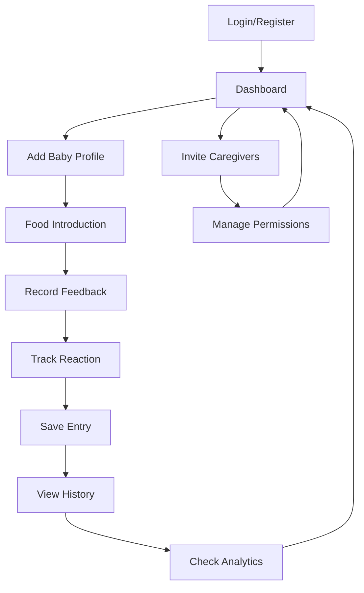
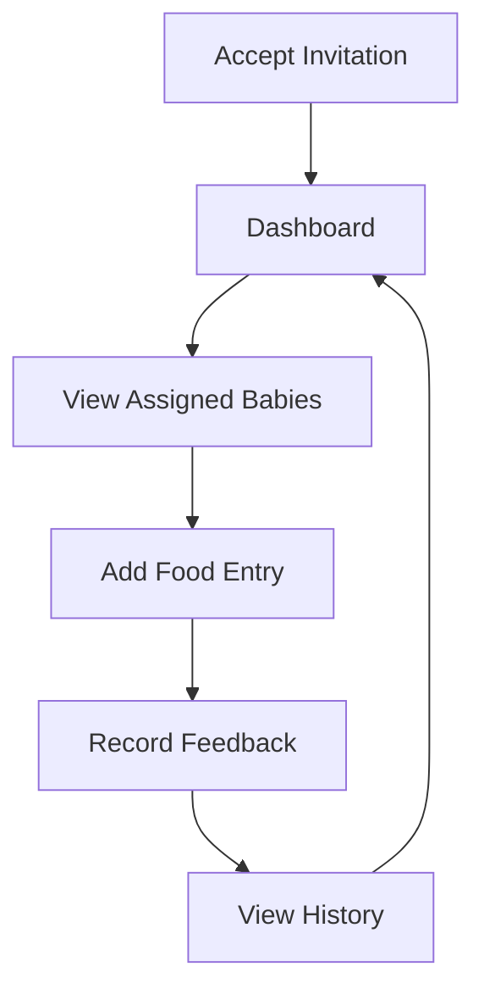

## 1. Product Overview

A comprehensive mobile-first baby food tracking application that helps parents monitor and manage their baby's solid food introduction journey. The app enables systematic tracking of food introductions, allergic reactions, and baby's preferences while supporting multiple caregivers and multilingual families.

Target users: Parents, caregivers, and healthcare providers managing infant nutrition during the critical 6+ months solid food introduction phase.

## 2. Core Features

### 2.1 User Roles

| Role                | Registration Method               | Core Permissions                                  |
| ------------------- | --------------------------------- | ------------------------------------------------- |
| Primary Parent      | Username/password via Better Auth | Full access to all babies, can manage other users |
| Secondary Caregiver | Invitation from primary parent    | Can track foods for assigned babies, view history |
| Healthcare Provider | Special registration code         | Read-only access to baby's food history           |

### 2.2 Feature Module

Our baby food tracking application consists of the following main pages:

1. **Dashboard**: Overview of all babies, recent activities, quick stats
2. **Baby Profile**: Baby information, growth tracking, settings
3. **Food Introduction**: Add new foods, record feedback and reactions
4. **Food History**: Timeline view of all introduced foods with details
5. **Analytics**: Progress charts, allergy tracking, preferences summary
6. **Settings**: User profile, language selection, notification preferences
7. **User Management**: Invite caregivers, manage permissions

### 2.3 Page Details

| Page Name         | Module Name        | Feature description                                                |
| ----------------- | ------------------ | ------------------------------------------------------------------ |
| Dashboard         | Baby Cards         | Display all babies with profile pictures, age, and recent activity |
| Dashboard         | Quick Actions      | One-tap access to add food, view history, check analytics          |
| Dashboard         | Recent Activity    | Timeline of latest food introductions across all babies            |
| Baby Profile      | Basic Info         | Name, birth date, photo, current age calculation                   |
| Baby Profile      | Growth Tracking    | Weight, height, head circumference with percentile charts          |
| Baby Profile      | Settings           | Notification preferences, data export, delete account              |
| Food Introduction | Food Selector      | Searchable database of baby-safe foods with categories             |
| Food Introduction | Feedback Recording | 5-point emoji scale (😞 to 😍) for taste preference                |
| Food Introduction | Reaction Tracking  | 4-point scale (none to severe) with symptom checklist              |
| Food Introduction | Photo Attachment   | Add photos of food and baby's reaction                             |
| Food History      | Timeline View      | Chronological list of all food introductions                       |
| Food History      | Filter & Search    | Filter by food type, reaction severity, date range                 |
| Food History      | Food Details       | Complete history of each food with all attempts                    |
| Analytics         | Progress Chart     | Visual timeline of food introduction progress                      |
| Analytics         | Allergy Summary    | List of foods with reactions, severity indicators                  |
| Analytics         | Preferences        | Most/least liked foods with success rate                           |
| Settings          | User Profile       | Username, email, password management                               |
| Settings          | Language           | Switch between English and Spanish                                 |
| Settings          | Notifications      | Push notification preferences for reminders                        |
| User Management   | Invite Users       | Generate invitation codes for caregivers                           |
| User Management   | Permission Control | Assign baby access and editing rights                              |

## 3. Core Process

### Primary Parent Flow

### Secondary Caregiver Flow

## 4. User Interface Design

### 4.1 Design Style

- **Primary Colors**: Soft coral (#FF6B6B) for CTAs, mint green (#4ECDC4) for success states
- **Secondary Colors**: Warm gray (#F7F7F7) backgrounds, white cards with subtle shadows
- **Button Style**: Rounded corners (8px radius), generous touch targets (44px minimum)
- **Typography**: System fonts for performance, 16px base size, clear hierarchy
- **Icon Style**: Rounded line icons, emoji-based feedback system
- **Layout**: Card-based design with generous whitespace, mobile-first grid system

### 4.2 Page Design Overview

| Page Name         | Module Name    | UI Elements                                                                    |
| ----------------- | -------------- | ------------------------------------------------------------------------------ |
| Dashboard         | Baby Cards     | Circular baby photos, name in bold 18px, age in 14px gray, activity badges     |
| Dashboard         | Quick Actions  | Large touch-friendly buttons (88px) with icons and labels, bottom navigation   |
| Food Introduction | Food Selector  | Search bar with instant filtering, categorized food grid, recent foods section |
| Food Introduction | Feedback Scale | Horizontal emoji slider with 5 faces, tap to select, visual feedback           |
| Food History      | Timeline Cards | Date headers, food photos, emoji ratings, reaction indicators, swipe actions   |
| Analytics         | Charts         | Simple bar/line charts with large touch points, color-coded sections           |
| Settings          | Menu Items     | Full-width rows with icons, clear separators, touch feedback                   |

### 4.3 Responsiveness

- **Mobile-first approach**: Designed for 320px minimum width
- **Breakpoint progression**: 320px → 375px → 768px → 1024px → 1440px
- **Touch optimization**: Minimum 44px touch targets, thumb-friendly navigation
- **Desktop enhancement**: Side navigation on larger screens, multi-column layouts
- **Tablet optimization**: Two-column grid for baby cards, larger charts

### 4.4 Accessibility

- WCAG 2.1 AA compliance minimum
- High contrast mode support
- Screen reader optimized with proper ARIA labels
- Keyboard navigation support
- Color-blind friendly palette alternatives
