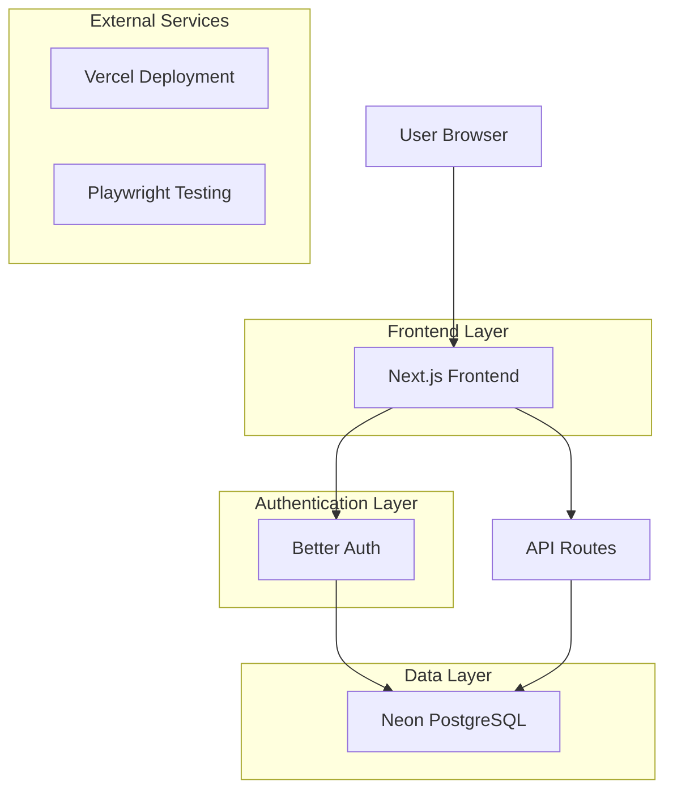
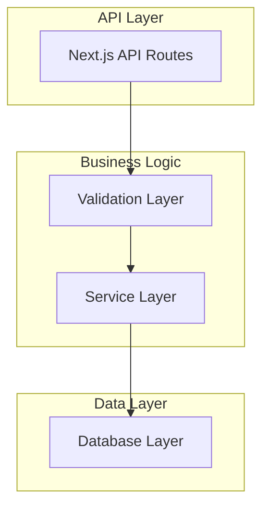
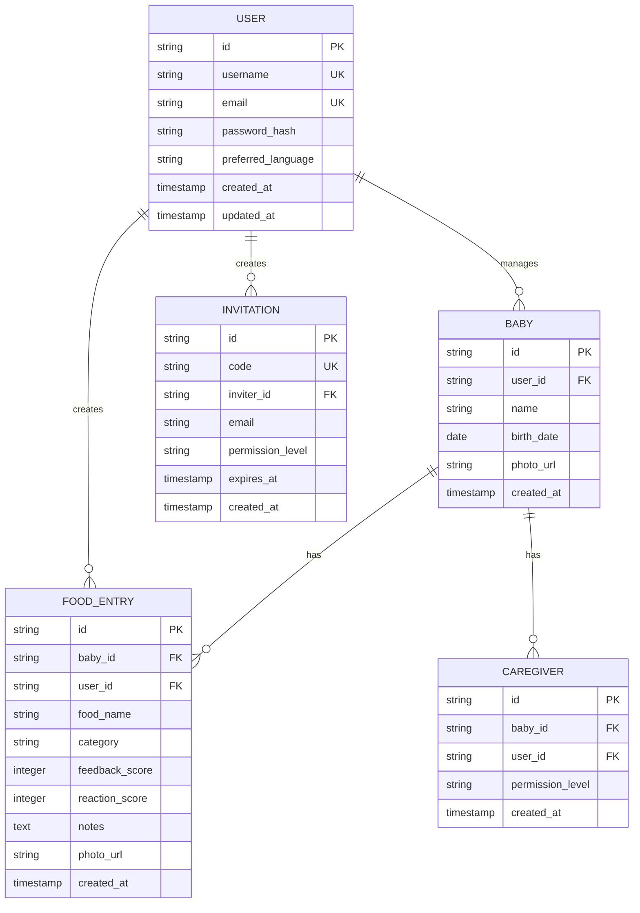

## 1. Architecture design



## 2. Technology Description

- **Frontend**: Next.js\@14 + TypeScript + CSS Modules

- **Initialization Tool**: create-next-app

- **Authentication**: Better Auth

- **Database**: Neon PostgreSQL

- **Testing**: Playwright + **Vitest**

- **Package Manager**: pnpm with strict version control

### Dependency Management Configuration

- pnpm configuration to prevent packages newer than 1 week

- Exact version pinning (no caret ^ symbols)

- Manual dependency updates only

- Minimal external dependencies policy

## 3. Route definitions

| Route                 | Purpose                         |
| --------------------- | ------------------------------- |
| /                     | Dashboard with baby overview    |
| /auth/login           | User authentication page        |
| /auth/register        | User registration page          |
| /baby/\[id]           | Individual baby profile page    |
| /baby/\[id]/add-food  | Food introduction form          |
| /baby/\[id]/history   | Food history timeline           |
| /baby/\[id]/analytics | Progress charts and insights    |
| /settings             | User preferences and profile    |
| /settings/language    | Language selection interface    |
| /invite/\[code]       | Caregiver invitation acceptance |

## 4. API definitions

### 4.1 Authentication APIs

**User Registration**

```
POST /api/auth/register
```

Request:

| Param Name | Param Type | isRequired | Description                 |
| ---------- | ---------- | ---------- | --------------------------- |
| username   | string     | true       | Unique username             |
| email      | string     | true       | User email address          |
| password   | string     | true       | Password (min 8 characters) |

Response:

| Param Name | Param Type | Description         |
| ---------- | ---------- | ------------------- |
| success    | boolean    | Registration status |
| userId     | string     | New user identifier |

### 4.2 Baby Management APIs

**Create Baby Profile**

```
POST /api/babies
```

Request:

| Param Name | Param Type | isRequired | Description             |
| ---------- | ---------- | ---------- | ----------------------- |
| name       | string     | true       | Baby's name             |
| birthDate  | date       | true       | Birth date (YYYY-MM-DD) |
| photo      | file       | false      | Profile photo           |

**Add Food Entry**

```
POST /api/babies/[id]/foods
```

Request:

| Param Name | Param Type | isRequired | Description                                             |
| ---------- | ---------- | ---------- | ------------------------------------------------------- |
| foodName   | string     | true       | Name of the food                                        |
| category   | string     | true       | Food category (fruit, vegetable, grain, protein, dairy) |
| feedback   | number     | true       | Taste feedback (1-5 scale)                              |
| reaction   | number     | true       | Allergic reaction (0-3 scale)                           |
| notes      | string     | false      | Additional notes                                        |
| photo      | file       | false      | Food/reaction photo                                     |

## 5. Server architecture diagram



## 6. Data model

### 6.1 Data model definition



### 6.2 Data Definition Language

**User Table**

```sql
CREATE TABLE users (
    id UUID PRIMARY KEY DEFAULT gen_random_uuid(),
    username VARCHAR(50) UNIQUE NOT NULL,
    email VARCHAR(255) UNIQUE NOT NULL,
    password_hash VARCHAR(255) NOT NULL,
    preferred_language VARCHAR(10) DEFAULT 'en',
    created_at TIMESTAMP WITH TIME ZONE DEFAULT NOW(),
    updated_at TIMESTAMP WITH TIME ZONE DEFAULT NOW()
);

CREATE INDEX idx_users_username ON users(username);
CREATE INDEX idx_users_email ON users(email);
```

**Baby Table**

```sql
CREATE TABLE babies (
    id UUID PRIMARY KEY DEFAULT gen_random_uuid(),
    user_id UUID NOT NULL REFERENCES users(id) ON DELETE CASCADE,
    name VARCHAR(100) NOT NULL,
    birth_date DATE NOT NULL,
    photo_url VARCHAR(500),
    created_at TIMESTAMP WITH TIME ZONE DEFAULT NOW(),
    updated_at TIMESTAMP WITH TIME ZONE DEFAULT NOW()
);

CREATE INDEX idx_babies_user_id ON babies(user_id);
CREATE INDEX idx_babies_created_at ON babies(created_at DESC);
```

**Food Entry Table**

```sql
CREATE TABLE food_entries (
    id UUID PRIMARY KEY DEFAULT gen_random_uuid(),
    baby_id UUID NOT NULL REFERENCES babies(id) ON DELETE CASCADE,
    user_id UUID NOT NULL REFERENCES users(id) ON DELETE CASCADE,
    food_name VARCHAR(100) NOT NULL,
    category VARCHAR(50) NOT NULL,
    feedback_score INTEGER CHECK (feedback_score >= 1 AND feedback_score <= 5),
    reaction_score INTEGER CHECK (reaction_score >= 0 AND reaction_score <= 3),
    notes TEXT,
    photo_url VARCHAR(500),
    created_at TIMESTAMP WITH TIME ZONE DEFAULT NOW()
);

CREATE INDEX idx_food_entries_baby_id ON food_entries(baby_id);
CREATE INDEX idx_food_entries_created_at ON food_entries(created_at DESC);
CREATE INDEX idx_food_entries_food_name ON food_entries(food_name);
```

**Caregiver Table**

```sql
CREATE TABLE caregivers (
    id UUID PRIMARY KEY DEFAULT gen_random_uuid(),
    baby_id UUID NOT NULL REFERENCES babies(id) ON DELETE CASCADE,
    user_id UUID NOT NULL REFERENCES users(id) ON DELETE CASCADE,
    permission_level VARCHAR(20) DEFAULT 'editor' CHECK (permission_level IN ('viewer', 'editor')),
    created_at TIMESTAMP WITH TIME ZONE DEFAULT NOW(),
    UNIQUE(baby_id, user_id)
);

CREATE INDEX idx_caregivers_baby_id ON caregivers(baby_id);
CREATE INDEX idx_caregivers_user_id ON caregivers(user_id);
```

### 6.3 Component Architecture

**systemUI Folder Structure**

```
systemUI/
├── components/
│   ├── Button/
│   │   ├── Button.module.css
│   │   └── Button.tsx
│   ├── Card/
│   │   ├── Card.module.css
│   │   └── Card.tsx
│   ├── Input/
│   │   ├── Input.module.css
│   │   └── Input.tsx
│   └── EmojiScale/
│       ├── EmojiScale.module.css
│       └── EmojiScale.tsx
├── layout/
│   ├── Header/
│   ├── Navigation/
│   └── Container/
└── theme.css
```

**theme.css Design Tokens**

```css
:root {
  /* Colors */
  --color-primary: #ff6b6b;
  --color-secondary: #4ecdc4;
  --color-background: #f7f7f7;
  --color-surface: #ffffff;
  --color-text: #333333;
  --color-text-secondary: #666666;

  /* Spacing */
  --spacing-xs: 4px;
  --spacing-sm: 8px;
  --spacing-md: 16px;
  --spacing-lg: 24px;
  --spacing-xl: 32px;

  /* Typography */
  --font-size-sm: 14px;
  --font-size-base: 16px;
  --font-size-lg: 18px;
  --font-size-xl: 24px;

  /* Borders */
  --border-radius-sm: 4px;
  --border-radius-md: 8px;
  --border-radius-lg: 12px;

  /* Shadows */
  --shadow-sm: 0 1px 3px rgba(0, 0, 0, 0.1);
  --shadow-md: 0 4px 6px rgba(0, 0, 0, 0.1);
  --shadow-lg: 0 10px 15px rgba(0, 0, 0, 0.1);
}
```
